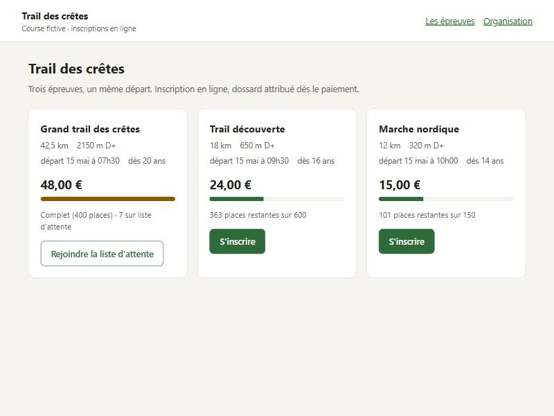
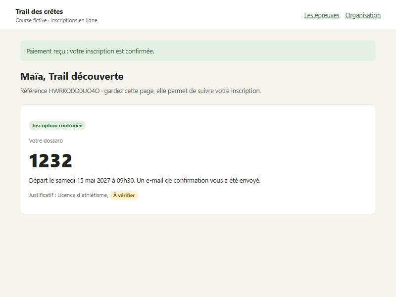
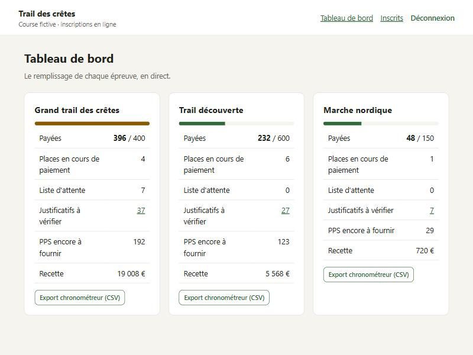

# Inscriptions au trail

[](https://github.com/brakan1337/inscriptions-trail/actions/workflows/ci.yml)

Les inscriptions en ligne d'un trail de 1 150 coureurs : quotas par épreuve, place réservée le temps de payer, liste d'attente qui se libère toute seule, dossards attribués au paiement, licence ou PPS à vérifier, et export pour le chronométreur.

**PHP 8.4 · Laravel 13 · Blade · Eloquent · MySQL · SQLite · PHPUnit · Pint · GitHub Actions**



## Le brief

> Ce projet est un cas d'étude. La course, ses coureurs et ses montants sont fictifs ; le brief sert à justifier les choix techniques.

Une association organise un trail de printemps avec trois épreuves. Jusqu'ici, les inscriptions passent par un tableur et des virements. Les épreuves se remplissent en quelques jours. Les désistements libèrent des places que personne ne réattribue. Les dossards se font à la main la veille de la course.

**Pourquoi PHP et Laravel :** le site de l'association est chez un hébergeur mutualisé, qui fait tourner du PHP et du MySQL, sans serveur à administrer. L'agence web qui maintiendra l'outil ne travaille qu'en Laravel. Le projet tient donc ces deux contraintes :
- aucun processus permanent : une seule tâche cron lance le planificateur de Laravel chaque minute ;
- aucune compilation front-end : des vues Blade et une feuille de style ;
- MySQL en production : la CI rejoue tous les tests sur MySQL.

## Ce que fait l'application

**Côté coureur :**
- **Réservation de 30 minutes** : en remplissant le formulaire, le coureur bloque une place le temps de payer. Une réservation échue cesse de compter tout de suite, même avant le passage de la tâche planifiée.
- **Liste d'attente** : quand l'épreuve est complète, la demande prend un rang. Le coureur voit sa position sur sa page de suivi.
- **Place proposée** : dès qu'une place se libère (réservation non payée, annulation), elle est proposée au premier de la liste par e-mail, avec 48 heures pour payer. Sans paiement, elle passe au suivant.
- **Dossard au paiement** : le plus petit numéro libre de la plage de l'épreuve (1 à 999 pour le grand trail, 1001 à 1999 pour le trail découverte…). Un dossard libéré par une annulation est réutilisé.
- **Licence ou PPS** : sans licence d'athlétisme, il faut un PPS (Parcours Prévention Santé), valable trois mois. Le formulaire refuse un PPS qui aura expiré le jour de la course.

  Six mois avant la course, aucun PPS ne peut encore être valable. Le coureur s'inscrit alors avec « PPS à fournir », puis l'ajoute depuis sa page de suivi quand la période de trois mois s'ouvre.



**Côté organisation**, derrière une connexion :
- le remplissage de chaque épreuve, les places en cours de paiement, la liste d'attente, les justificatifs à vérifier, les PPS encore à fournir et la recette ;
- la liste des inscrits, filtrable, avec validation ou refus motivé des justificatifs, et annulation d'une inscription ;
- l'**export du chronométreur** : un fichier CSV par épreuve, trié par dossard, avec la catégorie d'âge. Il utilise le point-virgule et l'encodage UTF-8 avec BOM, pour s'ouvrir correctement dans un Excel français.



## Les choix qui comptent

- **Pas de survente.** Toute opération qui touche aux places se fait dans une transaction qui verrouille la ligne de l'épreuve (`lockForUpdate`). Deux coureurs qui valident la dernière place au même instant ne l'obtiennent pas tous les deux. La base refuse aussi deux fois le même dossard sur une épreuve (index unique).
- **Les règles au même endroit.** Places, liste d'attente, dossards et validité du PPS vivent dans [`Guichet`](app/Services/Guichet.php). Les contrôleurs ne font que l'appeler, la tâche planifiée aussi.
- **Paiement remplaçable.** L'application ne connaît que l'interface [`Passerelle`](app/Paiement/Passerelle.php). Le paiement simulé fourni pour la démonstration utilise des adresses signées et limitées dans le temps : impossible de valider un paiement en tapant une URL. Brancher Stripe, HelloAsso ou une banque ne touche qu'une classe et une ligne de configuration.
- **Une confirmation reçue deux fois ne fait pas payer deux fois.** Les prestataires de paiement renvoient parfois leur notification : le guichet l'ignore si l'inscription est déjà payée.
- **Les e-mails partent après la transaction.** Jamais d'offre annoncée puis annulée par un retour en arrière.
- **La page de suivi s'ouvre par une référence aléatoire de 12 caractères**, sans compte coureur à créer. Les formulaires publics et la connexion sont limités en débit.

## Lancer le projet

Avec PHP 8.4 et Composer :

```bash
composer install && cp .env.example .env && php artisan key:generate
```

```bash
php artisan migrate --seed
```

```bash
php artisan serve
```

Puis http://localhost:8000. Le back-office se trouve sous `/organisation`, avec le compte de démonstration **organisation@trail.example** / **demo-organisation**, qui n'existe que dans les données d'essai. Les e-mails s'écrivent dans `storage/logs/laravel.log`.

Les données de démonstration couvrent une course dans six mois. Le grand trail est complet, avec 7 coureurs en liste d'attente. Le trail découverte et la marche se remplissent.

En production, sur l'hébergement mutualisé, une seule tâche cron suffit :

```bash
* * * * * php /chemin/vers/le/site/artisan schedule:run
```

## Tests

```bash
php artisan test
```

40 tests :
- **Inscriptions** : réservation, liste d'attente dans l'ordre, réservation échue qui libère sa place, PPS refusé ou accepté, PPS fourni après coup, âge minimum au jour de la course, doublon, période d'inscription.
- **Paiement** : du bouton au dossard, adresses signées retouchées refusées, double confirmation, dossard libre réutilisé, délai dépassé.
- **Liste d'attente** : offre au premier, offre expirée qui passe au suivant, place offerte payée, aucune sollicitation après la clôture.
- **Organisation** : connexion, tableau de bord, justificatifs, annulation qui relance la liste d'attente, export du chronométreur.
- **Catégories d'âge.**

La CI vérifie le style (Pint) et la compilation des vues. Elle rejoue les tests sur SQLite puis sur MySQL 8.4, et charge les données de démonstration sur MySQL.

*Les catégories d'âge suivent une règle simplifiée : l'âge atteint dans l'année de la course. L'organisateur confirme la grille officielle de la saison avant la course.*
